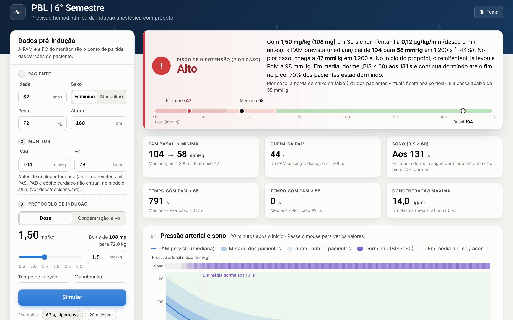
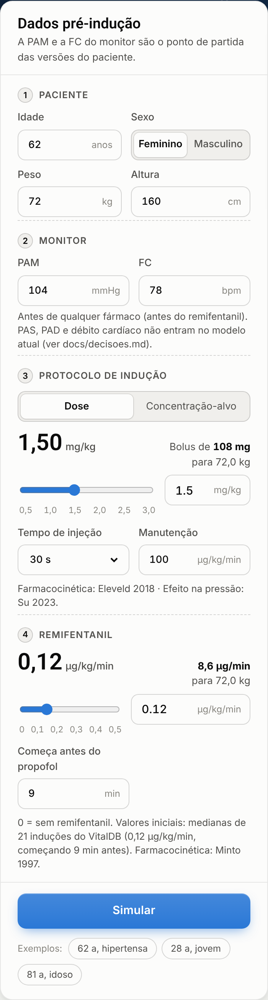
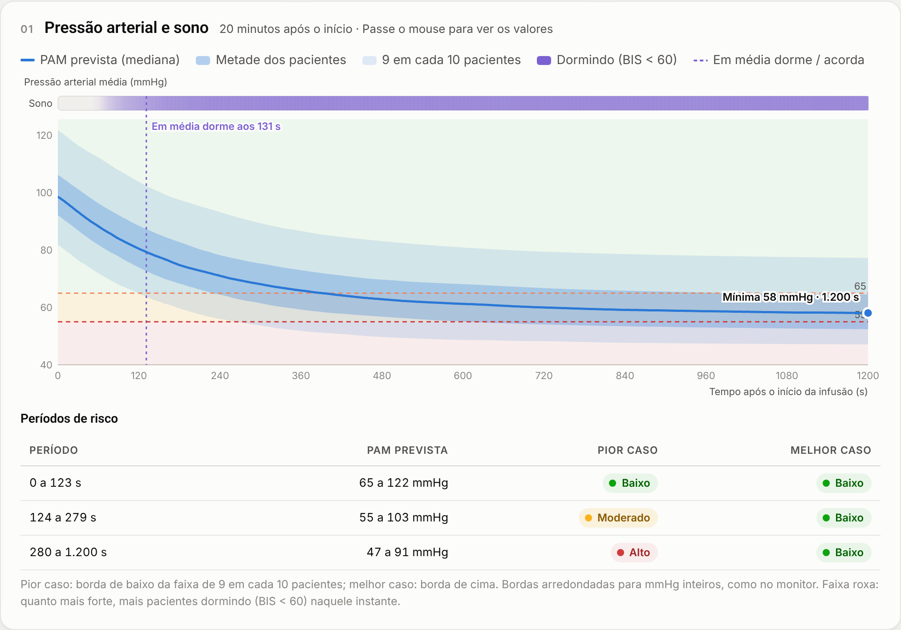
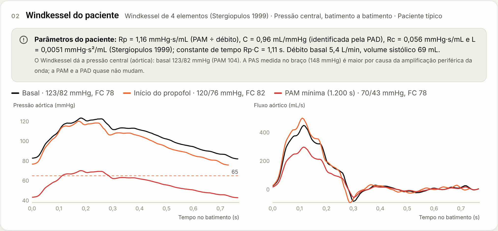
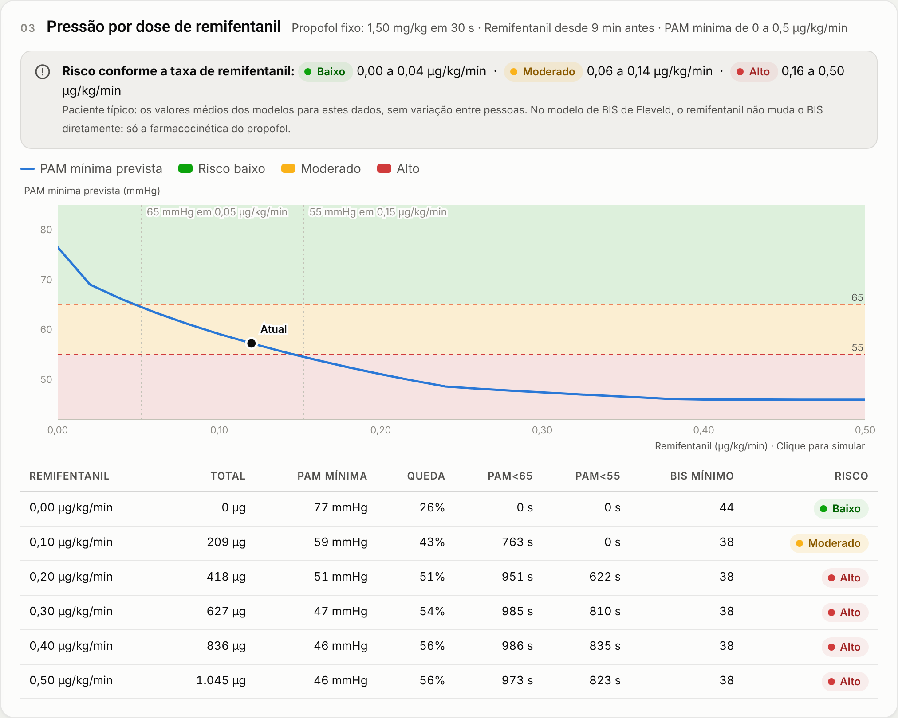
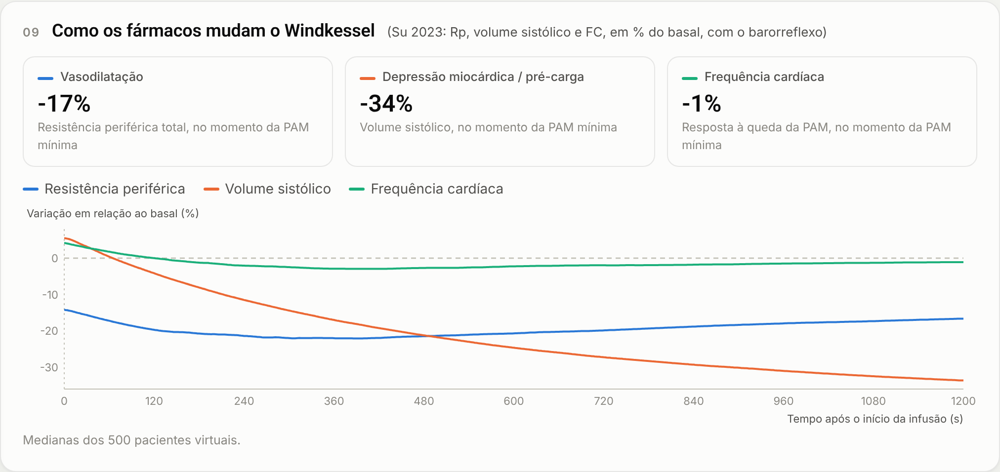

# PropofolWK

Simulador da **pressão arterial** na indução da anestesia com **propofol** e, se o médico escolher,
**remifentanil**, construído sobre um **modelo Windkessel de 4 elementos** da árvore arterial do paciente.
A pressão é calculada batimento a batimento (PAS, PAD e PAM), junto com a **profundidade anestésica
(BIS)**, e mostrada como **faixas** que representam a variabilidade entre pacientes, com os **períodos de
risco de hipotensão** e gráficos de **pressão por dose**, em uma plataforma local que o médico usa sem
programar.



> Ferramenta de ensino e pesquisa (PBL, 6º semestre de Engenharia Biomédica, Modelagem do Sistema
> Cardiovascular). Os efeitos dos fármacos na circulação vêm de um estudo em voluntários saudáveis e o
> modelo ainda não foi comparado à pressão medida em pacientes: **não use para decisões clínicas.**

## Sumário

- [O que o simulador faz](#o-que-o-simulador-faz)
- [Como instalar e abrir](#como-instalar-e-abrir)
- [Como o modelo funciona](#como-o-modelo-funciona)
- [O que a plataforma mostra](#o-que-a-plataforma-mostra)
- [Dados do VitalDB](#dados-do-vitaldb)
- [Verificação](#verificação)
- [Exemplo: pacientes A, B e C](#exemplo-pacientes-a-b-e-c)
- [Uso no Julia e estrutura do código](#uso-no-julia-e-estrutura-do-código)
- [Limitações e próximos passos](#limitações-e-próximos-passos)
- [Documentação](#documentação)
- [Referências](#referências)
- [Equipe](#equipe)

## O que o simulador faz

A partir dos dados do paciente, monta o **Windkessel dele** (resistência periférica, complacência,
impedância da aorta e inertância) e simula, nos 20 minutos após o início do propofol:

- a **onda de pressão aórtica** de cada batimento, com **PAS, PAD e PAM**;
- a **frequência cardíaca**, o **volume sistólico** e o **débito cardíaco**;
- o **BIS** e quando o paciente dorme (BIS < 60) e acorda;
- as **concentrações** de propofol e de remifentanil no sangue;
- os **períodos de risco**: baixo (PAM ≥ 65 mmHg), moderado (55 a 64) e alto (< 55);
- a **PAM mínima para cada dose** de propofol e de remifentanil.

Tudo é calculado para **500 pacientes virtuais**: versões do mesmo paciente com os parâmetros sorteados
dentro da variabilidade publicada nos artigos. Só entram modelos e valores publicados e verificados; cada
escolha está registrada, com a fonte, em [`docs/decisoes.md`](docs/decisoes.md).

## Como instalar e abrir

1. Instale o **Julia** (1.10 ou mais novo): [julialang.org/install](https://julialang.org/install/).
2. Baixe o projeto: botão verde **Code → Download ZIP** (ou `git clone`) e descompacte.
3. Dê **dois cliques** em **`abrir_plataforma.bat`** (Windows). Abre uma janela preta (o Julia) e, em
   seguida, a plataforma no navegador. Na primeira vez pode levar alguns minutos.
4. Não feche a janela preta enquanto usa a plataforma. Se o navegador não abrir, acesse
   `http://127.0.0.1:8080`.

Tudo roda no próprio computador: nenhum dado sai da máquina. O pacote usa só bibliotecas que já vêm
com o Julia (LinearAlgebra, Random e Sockets), sem nada para baixar da internet.

## Como o modelo funciona

O centro do modelo é a **circulação em malha fechada**: o coração ejeta sangue no Windkessel, o
Windkessel dá a pressão, e o barorreflexo responde à pressão mudando o coração e os vasos. Os fármacos
entram mudando os parâmetros do Windkessel.

```
                 ┌──────────── Windkessel de 4 elementos (Stergiopulos 1999) ────────────┐
coração ── Q(t) ─▶  Rc ∥ L  ──▶  C ∥ Rp                                                 ├─▶ PAS, PAD, PAM
 VS, FC          └────────────────────────────────▲─────────────────────────────────────┘        │
   ▲                                              │ Rp                                           │
   └──────── Su 2023: fármacos + barorreflexo (RPT, VS, FC como fração do basal) ◀── PAM ────────┘
                         ▲                         ▲
propofol (mg/s) → Eleveld 2018 → Cp    remifentanil (µg/s) → Minto 1997 → Cr
                                 └→ sítio de efeito → Ce → BIS (Eleveld 2018)
```

| Parte | Modelo | Fonte |
|---|---|---|
| **Árvore arterial (núcleo)** | **Windkessel de 4 elementos, batimento a batimento** | **Stergiopulos et al., 1999; windkessel-id** |
| Gêmeo digital | Rp pela lei de Ohm, C identificada pela PAD, DC pela superfície corporal | Mosteller, 1987; Agabiti-Rosei et al., 2007 |
| Variação de Rp, VS e FC | Renovação com feedback da PAM (barorreflexo) e interação propofol–remifentanil | Su et al., 2023 |
| Farmacocinética do propofol | 3 compartimentos; termos de opioide quando há remifentanil | Eleveld et al., 2018 |
| Farmacocinética do remifentanil | 3 compartimentos, massa magra de James | Minto et al., 1997 |
| Sono | Sítio de efeito (ke0), curva de Hill e atraso do monitor | Eleveld et al., 2018 |
| Variabilidade | 500 pacientes virtuais com as variâncias publicadas | Mesmos artigos |
| Risco | 65 e 55 mmHg | Salmasi et al., 2017; Walsh et al., 2013 |

### Windkessel de 4 elementos

Analogia elétrica: pressão = tensão, fluxo = corrente. **Rp** (resistência periférica, arteríolas) define
a pressão média; **C** (complacência arterial) guarda sangue na sístole e devolve na diástole; **Rc**
(impedância característica da aorta) e **L** (inertância do sangue), em paralelo, formam a pressão do
início da ejeção. Em espaço de estados (x₁ = volume em C, x₂ = fluxo em L × L):

```math
\dot{x}_1 = -\frac{x_1}{R_p C} + Q, \qquad \dot{x}_2 = -\frac{R_c}{L}\,x_2 + R_c\,Q, \qquad P = \frac{x_1}{C} - \frac{R_c}{L}\,x_2 + R_c\,Q
```

A matriz é diagonal, então a discretização é exata, com passo de 5 ms: x₁[k+1] = e^(−h/RpC)·x₁[k] + RpC·(1 − e^(−h/RpC))·Q[k] (e o análogo para x₂). O fluxo
Q(t) é o batimento de Stergiopulos (`dados/stergiopulos1999/aflow.csv`), esticado para 60/FC e escalado
para que o fluxo médio seja exatamente VS × FC/60. O batimento basal começa no estado periódico
x₀ = xₙ⁰/(1 − aⁿ), em que o batimento se repete igual.

**Gêmeo digital (parâmetros do paciente).**

- DC₀ = medido ou 3,0 L/min/m² × superfície corporal de Mosteller; VS₀ = DC₀/FC₀;
- **Rp = PAM/DC₀** (lei de Ohm da circulação: no regime médio, C não passa fluxo e L curto-circuita Rc);
- **C**: identificada por bissecção para que a **PAD** simulada seja a medida;
- Rc = 0,056 mmHg·s/mL e L = 0,0051 mmHg·s²/mL (Stergiopulos, 1999).

O Windkessel dá a pressão **central** (aórtica). A PAM e a PAD quase não mudam da aorta ao braço, mas a PAS
do manguito é amplificada na periferia (Agabiti-Rosei et al., 2007). Por isso C é ajustada pela PAD, e a
PAS central mostrada é menor que a do braço.

### Variação dos parâmetros durante a anestesia (modelo de Su)

A cada batimento, o modelo de Su dá as frações do basal da resistência (RPT), do volume sistólico e da
FC, e o Windkessel usa **Rp = Rp₀·RPT**, **VS = VS₀·VS_rel** e **FC = FC₀·FC_rel**. Cada fração segue
um modelo de renovação, com a PAM do batimento simulado como feedback do barorreflexo:

```math
\frac{dX}{dt} = k_{out}\left[\left(\frac{PAM}{PAM_0}\right)^{fb}\left(1 + E^{P}_{X}\right) - X\left(1 - E^{R}_{X}\right)\right], \qquad X \in \{RPT,\ VS,\ FC\}
```

k_out = 0,072/min e fb = −0,661. E^P é o efeito do propofol (vasodilatação e queda do volume sistólico,
maior nos idosos) e E^R, o do remifentanil, com os termos de interação do artigo. O estado avança a
duração do batimento por Runge-Kutta de 4ª ordem.

**Congruência.** Em regime, a PAM do Windkessel é Rp × DC = (PAM₀/DC₀)·RPT × DC₀·VS_rel·FC_rel =
PAM₀·RPT·VS_rel·FC_rel, exatamente a PAM do modelo de Su. O Windkessel acrescenta a onda de pressão
(PAS e PAD) e a dinâmica da complacência; a PAM só difere da do Su nos transitórios (no máximo 0,43 mmHg).

### Farmacocinética, BIS, pacientes virtuais e risco

**Farmacocinética.** Três compartimentos (sangue, rápido e lento), resolvidos de forma exata a cada segundo:

```math
\frac{dC_1}{dt} = -(k_{10}+k_{12}+k_{13})\,C_1 + k_{12}C_2 + k_{13}C_3 + \frac{u(t)}{V_1}, \qquad \frac{dC_i}{dt} = k_{i1}\,(C_1 - C_i)
```

**BIS.** O cérebro segue o sangue com atraso, e o BIS cai com a concentração no cérebro:

```math
\frac{dC_e}{dt} = k_{e0}\,(C_p - C_e), \qquad BIS = 93\left(1 - \frac{C_e^{\gamma}}{C_{e50}^{\gamma} + C_e^{\gamma}}\right)
```

com Ce50 = 3,08·e^(−0,00635·(idade − 35)) µg/ml, γ = 1,89 abaixo do Ce50 e 1,47 acima, e o atraso do
monitor de 15 + e^(0,0517·idade) s.

**Pacientes virtuais e faixas.** Cada parâmetro com variabilidade publicada é sorteado (log-normal:
valor típico × e^η, η ~ Normal(0, ω²); três do remifentanil são aditivos, como no PAS). Cada paciente
virtual tem a sua circulação simulada batimento a batimento; a cada segundo, os percentis 5–95% e
25–75% das 500 curvas formam as faixas.

**Risco.** O pior caso (percentil 5%), com a PAM arredondada para mmHg inteiros, como no monitor, é
classificado segundo a segundo; o nível do paciente é o do pior segundo.

Explicação completa, com todas as equações, valores e fontes:
[`docs/como_o_modelo_funciona.html`](docs/como_o_modelo_funciona.html) (baixe e abra no navegador).

## O que a plataforma mostra

### Ficha do paciente

| Seção | Campos |
|---|---|
| 1. Paciente | Idade, sexo, peso, altura |
| 2. Monitor | PAS, PAD, PAM e FC **antes de qualquer fármaco** (antes do remifentanil); débito cardíaco opcional (se vazio, é estimado) |
| 3. Protocolo de indução | **Dose** (mg/kg, tempo de injeção e manutenção em µg/kg/min) ou **concentração-alvo** no plasma (µg/ml, como numa bomba de TCI) |
| 4. Remifentanil | Taxa (µg/kg/min; 0 = sem remifentanil) e quantos minutos antes do propofol começou. Valores iniciais: 0,12 µg/kg/min e 9 min, as medianas de 21 induções do VitalDB |



### Resultados

No alto: o **nível de risco do pior caso** (5% dos pacientes virtuais ficam abaixo), uma régua com a PAM
basal, a mínima da mediana e a do pior caso, e os indicadores (PAM basal → mínima, queda, sono, tempo com
PAM < 65 e < 55, concentração máxima, PAS/PAD na PAM mínima). Abaixo, dez cartões:

**01 · Pressão arterial e sono (gráfico principal).** Mediana da PAM, faixa de metade dos pacientes,
faixa de 9 em cada 10, **PAS e PAD centrais** (tracejadas), zonas de risco, a faixa roxa no alto (quanto
mais forte, mais pacientes dormindo) e quando, em média, o paciente dorme e acorda. Embaixo, a tabela de
períodos de risco.



**02 · Windkessel do paciente.** Os parâmetros identificados (Rp, C, Rc, L, constante de tempo Rp·C,
débito e volume sistólico basais) e a **onda de pressão e de fluxo aórticos** em três batimentos: o basal,
o do início do propofol e o da PAM mínima.



**03 · Pressão por dose de propofol** (remifentanil fixo) e **04 · Pressão por dose de remifentanil**
(propofol fixo). PAM mínima do paciente típico para cada dose, sobre as zonas de risco, com as doses em que
o risco muda e a dose a partir da qual o paciente, em média, dorme. Clicar no gráfico simula aquela dose.




**05 · Profundidade anestésica (BIS).** Mediana, faixas, faixa-alvo de 40 a 60 e quando, em média, o
paciente dorme e acorda. O BIS aparece como o monitor mostra, com o atraso dele.


**06 · Frequência cardíaca**, **07 · Débito cardíaco**, **08 · Concentrações no plasma** (propofol e
remifentanil) e **09 · Como os fármacos mudam o Windkessel** (Rp, volume sistólico e FC em % do basal):



**10 · Paciente virtual:** todos os parâmetros usados, com a fonte, começando pelo Windkessel.


No rodapé: imprimir/salvar PDF e baixar as curvas em CSV (PAM, PAS, PAD, FC, débito, BIS e
concentrações). Há tema claro e escuro, e a página funciona no celular.


## Dados do VitalDB

O [VitalDB](https://vitaldb.net) é um banco aberto com 6.388 cirurgias. A seleção de casos (21 induções
com pressão invasiva e bomba de propofol) foi feita pelo grupo no repositório
[PBL_6](https://github.com/vivianguilger-lab/PBL_6), que também tem a primeira versão do Windkessel
(portada do windkessel-id). Aqui eles foram usados para:

- **descrever o remifentanil na prática:** em todas as 21 induções ele começou antes do propofol (mediana de
  9 min antes), com taxa média de 0,12 µg/kg/min. São os valores iniciais da plataforma;
- **conferir a farmacocinética de Minto:** com a taxa registrada pela bomba (`Orchestra/RFTN20_RATE`), a
  concentração de Minto diferiu da que a própria bomba mostrou (`Orchestra/RFTN20_CP`) em **0,97%**
  (mediana).

Tabela por caso: [`dados/remifentanil_vitaldb.csv`](dados/remifentanil_vitaldb.csv); script:
[`scripts/remifentanil_vitaldb.py`](scripts/remifentanil_vitaldb.py).

## Verificação

São 123 testes automáticos. As equações dos fármacos foram conferidas contra o
[Python Anesthesia Simulator](https://github.com/AnesthesiaSimulation/Python_Anesthesia_Simulator)
(PAS, commit 4afc03a):

| O que | Resultado |
|---|---|
| Concentração de propofol (com e sem opioide) e de remifentanil | diferença para o PAS < 10⁻¹³ |
| Modelo de Su (RPT, VS, FC), só propofol e com os dois fármacos | diferença para o PAS < 10⁻¹² |
| Concentração no cérebro e equação do BIS | idênticas ao PAS |
| Windkessel: batimento basal | PAM e PAD simuladas = medidas; o batimento periódico se repete igual |
| Windkessel × Su em malha fechada | PAM a no máximo 0,43 mmHg da do modelo de Su |

Os testes também conferem a concentração-alvo, o sorteio dos pacientes virtuais (média e variância), as
faixas e os períodos de risco e a plataforma. As tabelas de referência são geradas pelos scripts
`test/gerar_referencia_*.py`.

## Exemplo: pacientes A, B e C

**Windkessel identificado** (débito estimado pela superfície corporal):

| Paciente | PA no braço (mmHg) | Rp (mmHg·s/mL) | C (mL/mmHg) | Rp·C (s) | DC (L/min) | VS (mL) | PA central (mmHg) |
|---|---|---|---|---|---|---|---|
| A: mulher, 62 anos, 72 kg, 160 cm, FC 78 | 148/82 (PAM 104) | 1,16 | 0,96 | 1,11 | 5,4 | 69 | 123/82 |
| B: homem, 28 anos, 80 kg, 180 cm, FC 74 | 124/72 (PAM 89) | 0,89 | 1,47 | 1,31 | 6,0 | 81 | 104/72 |
| C: homem, 81 anos, 64 kg, 168 cm, FC 64 | 168/76 (PAM 107) | 1,24 | 0,78 | 0,97 | 5,2 | 81 | 137/76 |

O idoso (C) tem a menor complacência, coerente com artérias mais rígidas.

**Previsão.** Propofol em bolus de 30 s (1,5 mg/kg em A e C; 2,0 mg/kg em B) seguido de manutenção de
100 µg/kg/min, com e sem remifentanil (0,12 µg/kg/min desde 9 min antes):

| Paciente | Remifentanil | PAM mínima, mediana (mmHg) | Pior caso (mmHg) | PA central na PAM mínima | DC basal → mínimo (L/min) | Risco | Dorme aos |
|---|---|---|---|---|---|---|---|
| A | Sem | 77 (−26%) | 60 | 93/60 | 5,4 → 4,5 | Moderado | 149 s |
| | Com | 58 (−44%) | 47 | 71/44 | 5,4 → 3,5 | Alto | 131 s |
| B | Sem | 72 (−19%) | 57 | 86/56 | 6,0 → 5,8 | Moderado | 120 s |
| | Com | 58 (−35%) | 47 | 70/43 | 6,0 → 4,8 | Alto | 112 s |
| C | Sem | 66 (−38%) | 51 | 83/48 | 5,2 → 3,4 | Alto | 167 s |
| | Com | 48 (−55%) | 39 | 61/34 | 5,2 → 2,5 | Alto | 155 s |

Os três estão nos botões de exemplo da plataforma.

## Uso no Julia e estrutura do código

```julia
] activate .
] test                      # roda os testes

using PropofolWK
r = prever(idade = 62, peso = 72, altura = 160, sexo = "F", pas = 148, pad = 82, pam = 104, fc = 78,
           dose_mgkg = 1.5, duracao_bolus_s = 30, manutencao_mgkgh = 6,
           remi_ugkgmin = 0.12, remi_antes_s = 540)
r.wk                        # Windkessel do paciente: Rp, C, Rc, L, débito, VS, PA central basal
r.metricas                  # PAM mínima, pior caso, risco, PAS/PAD e débito na PAM mínima...
r.texto                     # períodos de risco em frases
plataforma()                # abre a plataforma

wk = parametrizar_windkessel(pam = 104, pad = 82, fc = 78, peso = 72, altura = 160)
b  = batimento(wk.Rp, wk.C, wk.Rc, wk.L, 78, wk.vs, wk.x0; guardar = true)   # um batimento: b.pressao, b.fluxo
```

| Arquivo | O que faz |
|---|---|
| **`src/windkessel.jl`** | **Windkessel de 4 elementos: batimento, estado periódico e parametrização do paciente** |
| **`src/circulacao.jl`** | **Malha fechada: Windkessel + modelo de Su (barorreflexo), batimento a batimento** |
| `src/hemodinamica.jl` | Modelo de Su (propofol, remifentanil e interações) |
| `src/farmacocinetica.jl` | Eleveld 2018: parâmetros do paciente e solução exata dos 3 compartimentos |
| `src/alvo.jl` | Concentração-alvo (TCI no plasma) |
| `src/remifentanil.jl` | Minto 1997 |
| `src/bis.jl` | Sítio de efeito e BIS de Eleveld |
| `src/populacao.jl` | Pacientes virtuais |
| `src/risco.jl` | Faixas, níveis e períodos de risco |
| `src/previsao.jl` | `prever`, pressão por dose (`risco_por_dose`, `risco_por_remi`) |
| `src/servidor.jl` | Servidor local da plataforma |
| `src/grafico.jl` | Gráfico da faixa em SVG |
| `app/index.html` | A página da plataforma |
| `dados/stergiopulos1999/` | Onda de fluxo e de pressão de Stergiopulos (do windkessel-id, licença MIT) |
| `test/` | Testes e scripts das tabelas de referência |
| `exemplos/prever_paciente.jl` | Exemplo de uso |

## Limitações e próximos passos

- Os efeitos dos fármacos na circulação foram estimados em voluntários saudáveis; falta comparar com a
  pressão medida nos casos do VitalDB e calibrar os parâmetros mais influentes.
- O Windkessel dá a pressão central: a amplificação da PAS até o braço não é representada.
- Rc, L e a forma da onda de fluxo são os de Stergiopulos para todos os pacientes, e a complacência fica
  constante durante a anestesia. Próximo passo: ajustar Rc e L com a pressão invasiva do VitalDB, como no
  windkessel-id.
- Sem débito medido, o débito basal é estimado pelo índice cardíaco normal (3,0 L/min/m²).
- Não entram laringoscopia, estímulo cirúrgico, fluidos, vasopressores, outros opioides e hipnóticos.
- Só parte dos parâmetros tem variabilidade publicada: as faixas provavelmente são mais estreitas que a realidade.
- No modelo de BIS de Eleveld, o remifentanil não entra diretamente no BIS.
- O risco é definido pelo pior segundo, sem tempo mínimo abaixo do limiar.

Pendências detalhadas em [`docs/decisoes.md`](docs/decisoes.md).

## Documentação

- [`docs/como_o_modelo_funciona.html`](docs/como_o_modelo_funciona.html): tudo sobre o modelo: matemática,
  valores, fontes, saídas, cada parte da plataforma e o código.
- [`docs/manual_medico.md`](docs/manual_medico.md): manual da plataforma para o médico.
- [`docs/decisoes.md`](docs/decisoes.md): cada decisão de método, com a fonte e a situação.

## Referências

- Stergiopulos N, Westerhof BE, Westerhof N. Total arterial inertance as the fourth element of the windkessel model. *Am J Physiol* 1999;276(1):H81–8. doi:10.1152/ajpheart.1999.276.1.H81
- Pigot H et al. windkessel-id. GitHub, 2021 (licença MIT). https://github.com/hpigot/windkessel-id
- Agabiti-Rosei E et al. Central blood pressure measurements and antihypertensive therapy: a consensus document. *Hypertension* 2007;50(1):154–60. doi:10.1161/HYPERTENSIONAHA.107.090068
- Mosteller RD. Simplified calculation of body-surface area. *N Engl J Med* 1987;317(17):1098.
- Su H et al. Pharmacodynamic mechanism-based interaction model for the haemodynamic effects of remifentanil and propofol in healthy volunteers. *Br J Anaesth* 2023;131(2):222–33. doi:10.1016/j.bja.2023.04.043
- Eleveld DJ et al. Pharmacokinetic–pharmacodynamic model for propofol for broad application in anaesthesia and sedation. *Br J Anaesth* 2018;120(5):942–59. doi:10.1016/j.bja.2018.01.018
- Minto CF et al. Influence of age and gender on the pharmacokinetics and pharmacodynamics of remifentanil: I. Model development. *Anesthesiology* 1997;86(1):10–23.
- Salmasi V et al. Relationship between intraoperative hypotension, defined by either reduction from baseline or absolute thresholds, and acute kidney and myocardial injury after noncardiac surgery. *Anesthesiology* 2017;126(1):47–65.
- Walsh M et al. Relationship between intraoperative mean arterial pressure and clinical outcomes after noncardiac surgery. *Anesthesiology* 2013;119(3):507–15.
- NICE. Depth of anaesthesia monitors – Bispectral Index (BIS), E-Entropy and Narcotrend-Compact M. Diagnostics guidance DG6, 2012.
- Lee HC et al. VitalDB, a high-fidelity multi-parameter vital signs database in surgical patients. *Sci Data* 2022;9:279.
- Aubouin-Pairault B et al. PAS: a Python Anesthesia Simulator for drug control. *J Open Source Softw* 2023;8(88):5480.

## Equipe

Grupo 5 · Engenharia Biomédica · Faculdade Israelita de Ciências da Saúde Albert Einstein · Project Based

Ana Paula Villela Segura, Beatriz Neves de Oliveira, Gustavo Frug Mauro, Leticia Kairuz, Maria Gabriela Medeiros von Adamek, Vivian Polakiewicz Guilger
Learning, 6º semestre (2026). Orientador: Federico Aletti.

Ana Paula Villela Segura, Beatriz Neves de Oliveira, Gustavo Frug Mauro, Leticia Kairuz, Maria Gabriela
Medeiros von Adamek e Vivian Polakiewicz Guilger.

Licença: GPL-3.0 (ver [`LICENSE`](LICENSE)).
